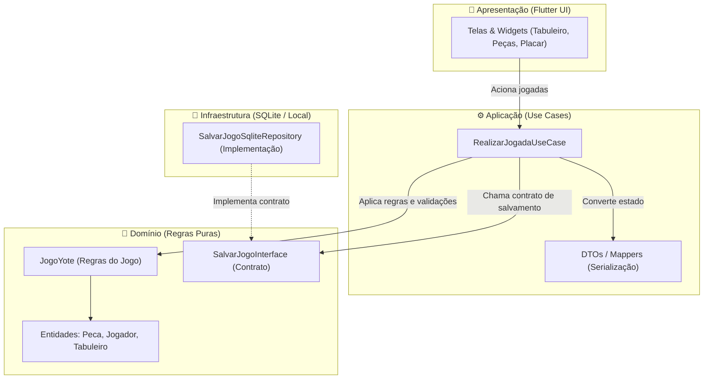

# ♟️ Tabuleiro Yoté

[](https://flutter.dev)
[](https://dart.dev)
[](#-arquitetura-do-software)
[](#-status-atual-vs-planejamento-futuro)

Uma implementação em **Flutter / Dart** do tradicional jogo de estratégia da África Ocidental: **Yoté**. O projeto foi estruturado seguindo os princípios de **Clean Architecture** (Arquitetura Limpa), visando desacoplar as regras de negócio puras da interface de usuário e dos mecanismos de armazenamento local.

---

## 📑 Sumário

- [Sobre o Jogo Yoté](#-sobre-o-jogo-yoté)
  - [Regras Principais](#regras-principais)
- [Arquitetura do Software](#-arquitetura-do-software)
  - [Camadas do Projeto](#camadas-do-projeto)
  - [Estrutura de Diretórios](#estrutura-de-diretórios)
- [Divisão em Módulos & Contratos](#-divisão-em-módulos--contratos)
  - [1. Domínio & Regras (Juiz)](#1-domínio--regras-juiz)
  - [2. Infraestrutura & Persistência (Arquivista / SQLite)](#2-infraestrutura--persistência-arquivista--sqlite)
  - [3. Apresentação & UI (Interface Flutter)](#3-apresentação--ui-interface-flutter)
- [Fluxo de Execução da Jogada](#-fluxo-de-execução-da-jogada)
- [Status Atual vs. Planejamento Futuro](#-status-atual-vs-planejamento-futuro)
- [Guia de Instalação e Execução](#-guia-de-instalação-e-execução)
- [Padrões de Desenvolvimento & Git](#-padrões-de-desenvolvimento--git)

---

## 🎲 Sobre o Jogo Yoté

O **Yoté** é um jogo de tabuleiro combinatório abstrato originário da África Ocidental (muito popular no Senegal e Mali). Conhecido por seu dinamismo e reviravoltas estratégicas, ele combina posicionamento de peças e saltos de captura com uma regra distintiva de confisco de peças adicionais.

### Regras Principais

1. **Tabuleiro e Peças**:
   - Tabuleiro em malha retangular de **5 linhas por 6 colunas** (30 casas no total).
   - Cada jogador inicia com **12 peças** (Brancas vs. Pretas) fora do tabuleiro.
2. **Fase de Colocação e Movimentação**:
   - Os jogadores alternam turnos.
   - No seu turno, o jogador pode optar por **colocar uma nova peça da mão** em qualquer casa desocupada do tabuleiro, **OU** **mover uma peça já em jogo** para uma casa adjacente ortogonalmente vazia (horizontal ou vertical, 1 casa por vez).
3. **Mecânica de Captura**:
   - Uma peça pode capturar uma peça adversária vizinha saltando sobre ela ortogonalmente (horizontal ou verticalmente) para uma casa vazia logo atrás.
4. **Regra de Bônus / Confisco (Diferencial do Yoté)**:
   - Ao realizar uma captura por salto, o jogador tem o direito imediato de **escolher e remover do tabuleiro uma segunda peça adversária qualquer** (peça de bônus), à sua escolha.
5. **Condição de Vitória**:
   - Vence o jogador que capturar todas as 12 peças do oponente ou bloquear todos os movimentos possíveis do adversário.

---

## 🏛️ Arquitetura do Software

O projeto adota uma separação estrita de responsabilidades baseada em **Clean Architecture**, permitindo que o desenvolvimento das regras, persistência e interface ocorra de maneira independente e testável.



### Camadas do Projeto

- **`domain` (Domínio)**: Contém as entidades centrais (`Peca`, `Jogador`, `Tabuleiro`), as regras de negócio puras do Yoté (`JogoYote`) e os contratos abstratos de repositório (`SalvarJogoInterface`). Não depende de bibliotecas externas nem do framework Flutter.
- **`application` (Aplicação)**: Contém os casos de uso (`RealizarJogadaUseCase`) que orquestram a comunicação entre a interface do usuário, o motor de regras e os contratos de infraestrutura.
- **`infrastructure` (Infraestrutura - Em desenvolvimento)**: Conterá a implementação concreta de persistência (ex: SQLite via `sqflite`) responsável por gravar e restaurar o estado do jogo.
- **`presentation` (Apresentação - Em desenvolvimento)**: Conterá a interface gráfica em Flutter, animações, gerenciamento de estado visual e captura de eventos de toque dos jogadores.

### Estrutura de Diretórios

```text
lib/
├── app/
│   └── app/
│       ├── application/
│       │   ├── dtos/                        # (Futuro) Objetos de transferência e serialização
│       │   └── usecases/
│       │       └── realizar_jogada_usecase.dart  # Orquestrador da execução de cada movimento
│       ├── domain/
│       │   ├── entities/
│       │   │   ├── jogador.dart             # Entidade Jogador (cor, peças na mão, capturas)
│       │   │   ├── peca.dart                # Entidade Peça (cor, coordenadas x e y)
│       │   │   └── tabuleiro.dart           # Representação da malha 5x6
│       │   ├── repositories/
│       │   │   └── salvar_jogo_repository.dart   # Contrato (interface) para persistência
│       │   └── rules/
│       │       └── tabuleiro_regras.dart    # Motor de regras do Yoté (JogoYote)
│       ├── infrastructure/                  # (Futuro) Banco de dados local (SQLite / Repositórios)
│       └── presentation/                    # (Futuro) Widgets, telas e controladores visuais
└── main.dart                                # Ponto de entrada da aplicação Flutter
```

---

## 👥 Divisão em Módulos & Contratos

Para facilitar o trabalho colaborativo entre múltiplos desenvolvedores, o sistema foi desenhado com contratos bem definidos:

### 1. Domínio & Regras (Juiz)
- **Responsabilidade**: Garantir que as regras oficiais sejam respeitadas (colocação, movimentação ortogonal de 1 casa, salto de 2 casas, validação de peça intermediária e bônus, alternância de turnos e detecção de vencedor).
- **Arquivos-chave**:
  - `tabuleiro_regras.dart` (`JogoYote`): Lança exceções explicativas caso uma jogada seja inválida.
  - `peca.dart`, `jogador.dart`, `tabuleiro.dart`.

### 2. Infraestrutura & Persistência (Arquivista / SQLite)
- **Responsabilidade**: Implementar a interface de persistência definida no domínio para armazenar o estado das partidas localmente em banco de dados SQLite.
- **Contrato a ser implementado**:
  ```dart
  abstract class SalvarJogoInterface {
    Future<void> salvarEstadoDoJogo(String estadoDoJogo);
    Future<String?> carregarUltimoJogo();
  }
  ```
- **Próximos passos**:
  - Criar classe concreta (ex: `SalvarJogoSqliteRepository implements SalvarJogoInterface`).
  - Utilizar tabelas SQLite para salvar o histórico de jogadas ou o JSON do estado atual.

### 3. Apresentação & UI (Interface Flutter)
- **Responsabilidade**: Desenvolver a interface interativa do jogo.
- **Como se conecta com a lógica**:
  - A interface instancia ou injeta o caso de uso `RealizarJogadaUseCase`.
  - Ao interagir com o tabuleiro na tela, a interface chama os métodos do caso de uso passando as coordenadas de origem, destino e cor do jogador da vez.
  - Se a regra rejeitar o movimento, captura o erro e exibe feedback amigável ao usuário.

---

## 🔄 Fluxo de Execução da Jogada

```
[ Usuário toca na tela ]
          │
          ▼
[ Flutter UI (Apresentação) ]
          │
          │ executa(xOrigem, yOrigem, xDestino, yDestino, cor)
          ▼
[ RealizarJogadaUseCase (Aplicação) ]
          │
          ├─► 1. regrasDoJogo.moverPeca(...) ──► [ JogoYote (Domínio) ]
          │      (Se movimento inválido ──► Dispara Exception e cancela)
          │
          ├─► 2. Serializa estado do jogo (JSON/DTO)
          │
          └─► 3. repositorioDeSalvamento.salvarEstadoDoJogo(...) ──► [ SQLite (Infraestrutura) ]
```

---

## 📊 Status Atual vs. Planejamento Futuro

| Módulo / Funcionalidade | Status | Descrição |
| :--- | :---: | :--- |
| **Entidades Centrais** | ✅ Concluído | Modelos de `Peca`, `Jogador` e `Tabuleiro` criados. |
| **Motor de Regras (Colocação & Movimento)** | ✅ Concluído | Validações de limites (5x6), casas ocupadas e movimentos ortogonais. |
| **Captura com Confisco (Regra Bônus)** | ✅ Concluído | Salto de 2 casas, remoção da peça saltada e confisco da peça bônus. |
| **Contrato de Salvamento** | ✅ Concluído | Interface `SalvarJogoInterface` estabelecida. |
| **Caso de Uso Inicial** | ✅ Concluído | `RealizarJogadaUseCase` orquestrando validação e salvamento. |
| **DTOs & Serialização Robusta** | 🟡 Em Planejamento | Estruturação de `app/application/dtos/` para conversão de matriz em JSON. |
| **Implementação SQLite** | 🟡 Em Planejamento | Criação do repositório SQLite integrado via `sqflite`. |
| **Saltos em Cadeia (Múltiplos)** | 🟡 Em Planejamento | Permitir capturas sucessivas no mesmo turno conforme variações da regra. |
| **Interface Gráfica do Tabuleiro** | 🟡 Em Planejamento | Renderização da grade 5x6, animação das peças e seleção visual da peça bônus. |
| **Suíte de Testes Unitários** | 🟡 Em Planejamento | Testes cobrindo cada regra do `JogoYote` e casos limites. |

---

## 🚀 Guia de Instalação e Execução

### Pré-requisitos

- [Flutter SDK](https://docs.flutter.dev/get-started/install) versão **>= 3.13.4**
- [Dart SDK](https://dart.dev/get-dart) versão **^3.13.4**
- Emulador Android/iOS ou dispositivo físico conectado

### Passo a Passo

1. **Clonar o repositório:**
   ```bash
   git clone https://github.com/seu-usuario/tabuleiro_yote.git
   cd tabuleiro_yote
   ```

2. **Obter as dependências do projeto:**
   ```bash
   flutter pub get
   ```

3. **Verificar a análise estática do código:**
   ```bash
   dart analyze
   ```

4. **Executar a aplicação:**
   ```bash
   flutter run
   ```

5. **Executar testes:**
   ```bash
   flutter test
   ```

---

## 🌿 Padrões de Desenvolvimento & Git

Para manter o histórico e a base de código organizados, adote as seguintes práticas:

- **Estratégia de Branches**:
  - `main`: Código de produção estável.
  - `dev`: Branch de integração das funcionalidades.
  - `feat/<nome-da-funcionalidade>`: Branches individuais para novas tarefas (ex: `feat/isac-regras`, `feat/sqlite-persistencia`, `feat/tabuleiro-ui`).
- **Padrão de Commits**:
  - Utilizar o padrão [Conventional Commits](https://www.conventionalcommits.org/):
    - `feat:` Nova funcionalidade adicionada.
    - `fix:` Correção de bug.
    - `docs:` Alterações na documentação.
    - `refactor:` Refatoração de código sem alteração de funcionalidade.
    - `test:` Adição ou modificação de testes.
